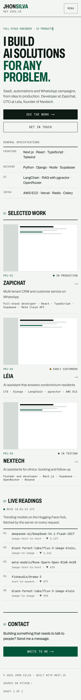
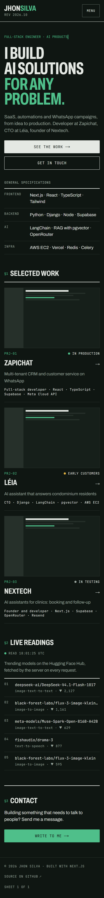
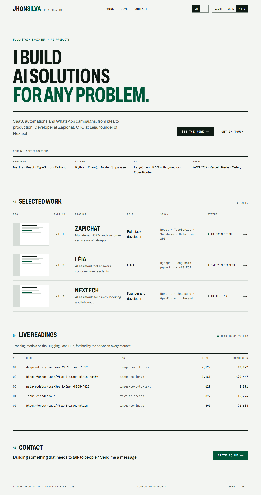
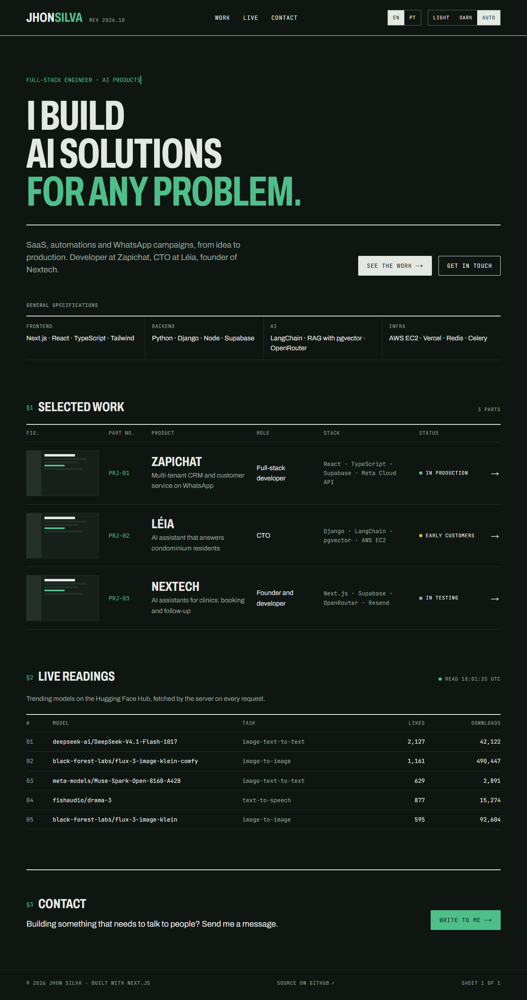

# Design note

## Direction

The site reads like the datasheet of a machine. Each project is a part with a number (PRJ-01), a spec table and a revision line. I build products where the details matter more than the decoration, and a spec sheet says that better than a hero image.

The look comes from my first portfolio, which used this palette. Going back to it made the site feel built for me, not for an interview test.

## References

- **Electronic component datasheets.** Part numbers, spec tables, the revision line and figure captions (FIG. 1).
- **PP Neue Montreal (neuemontreal.com).** Giant type as the layout, letters rising into place, and the contrast between huge display type and small mono labels.

## Decisions I changed

**Colour.** I started with near-black and an orange for contrast. It worked, but it looked like many developer portfolios, and the orange sat close to the contrast limit in small mono labels. I moved to the green, and to me it looks much better, especially across light and dark.

**Hero copy.** The first title, "I build AI products that run on WhatsApp", was true for my three projects, but too limited for what I can offer a client. I changed it to "I build AI solutions for any problem", with SaaS, automations and WhatsApp campaigns in the lead line.

**Real images.** The project pages started with placeholder figures. They read like claims without proof, so I replaced them with real screenshots of Zapichat, Léia and Nextech, with datasheet captions.

## Screenshots

| | Light | Dark |
|---|---|---|
| Mobile |  |  |
| Desktop |  |  |